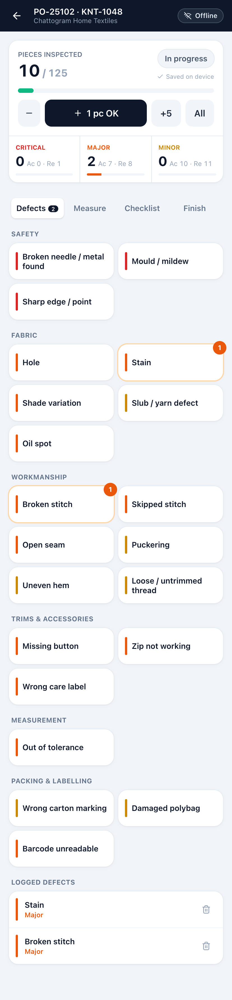
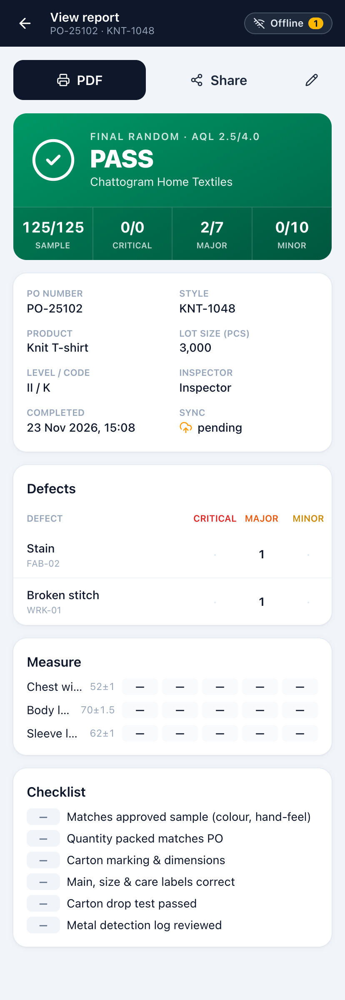
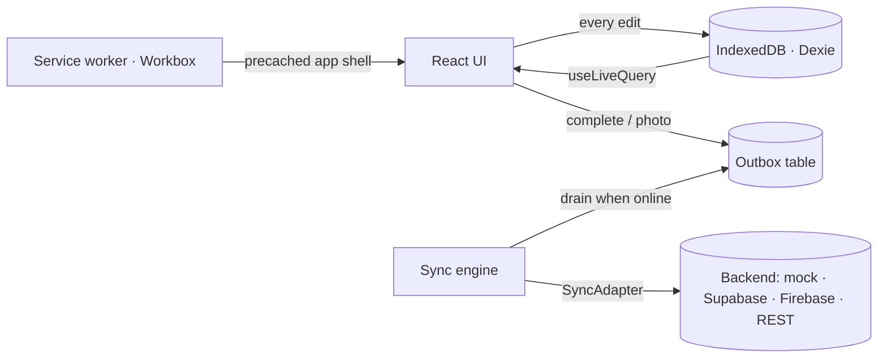
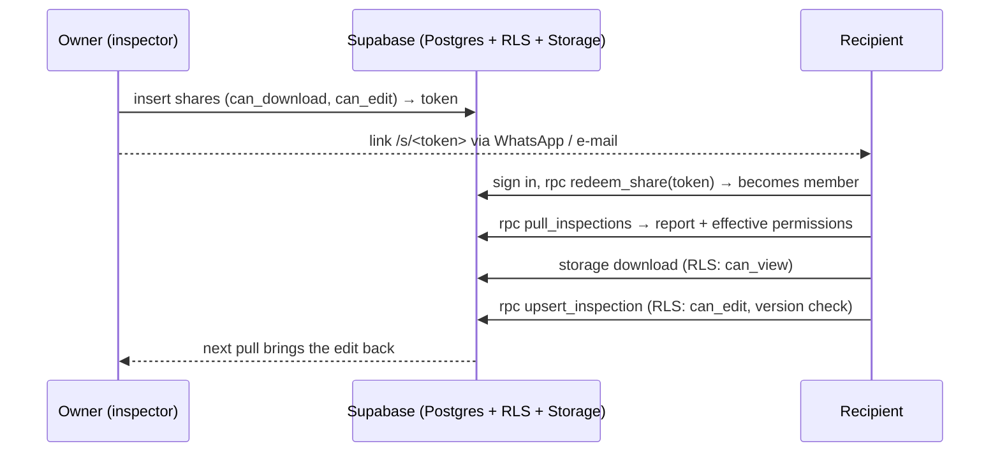

# QC Inspect — offline-first quality inspection PWA

A field app for garment and home-textile quality inspectors working inside factories where
connectivity is weak or absent. Inspectors run AQL inspections, log defects with photos,
take measurements and complete checklists — **entirely offline**. Everything syncs
automatically and safely when a signal returns.

> Built as a working prototype for a digital quality-management solution in the
> Bangladesh sourcing context. Factory names and inspection data are fictional demo data.

📘 **Using the app?** Read the **[User Guide](docs/USER_GUIDE.md)** — inspectors, managers and
people who receive a shared report. This README is for developers.

| Inspections | Live inspection | Defect + photo | Report | Insights |
|---|---|---|---|---|
|  |  |  |  |  |

## What it does

- **AQL sampling engine (ISO 2859-1 / ANSI Z1.4)** — enter lot size, inspection level and AQL
  values; the app derives the code letter, sample size and Ac/Re numbers, correctly resolving the
  standard's ↑/↓ arrows. Unit-tested against the published tables.
- **Live verdict** — critical / major / minor tallies against their rejection numbers. A lot is
  failed *as soon as* it reaches Re (saves inspector time); passes only once the full sample is checked.
- **Defect library** — 21 coded defects (safety, fabric, workmanship, trims, measurement, packing)
  with default severities the inspector can override; quantity, notes and photos per entry.
- **Photos** — camera capture, on-device resize + JPEG re-encode (4–6 MB → ~300 KB) before
  storage, uploaded in the background as the inspection progresses.
- **Measurements** — points of measure × 5 pieces with tolerance highlighting.
- **Checklist** — approved sample, quantity, carton, labels, drop test, metal detection.
- **Report** — printable / PDF, share sheet, compression savings, sync status.
- **Insights** — pass rate, DHU (defects per hundred units), pass rate by factory, Pareto of top
  defects, **CSV export** for Google Sheets / Excel.
- **English / বাংলা** — UI and defect names switch language, so line QC can use it in their own language.
- **Network simulator** — force *Offline* or *Flaky 3G* (40% of requests dropped) to demo sync behaviour.
- **Generated PDF report** — built on the device with jsPDF (works offline): verdict, sampling plan,
  colour-coded defect / measurement / checklist tables, photo pages. **Preview** in-app (pdf.js,
  works on Android/iOS where browsers can't show PDFs inline) and **Download**.
- **Attach existing reports** — upload any PDF (third-party inspection, lab test) to an inspection;
  stored offline first, synced through the same outbox, previewed in-app.
- **Send with permissions** — create a link for the report (+ attachments), share via WhatsApp,
  e-mail, copy or the native share sheet. Each link carries **View** (always), **Download** and
  **Edit** switches the owner can change or **revoke** at any time, and shows who opened it.
  Enforced by Postgres Row Level Security — not just hidden buttons.
- **Two-way sync** — edits by a colleague with edit permission flow back to the owner's device;
  local unsynced work is never overwritten; revoked reports disappear from the recipient's device.
- **Inspection templates** (`src/lib/templates.ts`) — apparel tops / bottoms, towels, bed linen,
  ceramics & tableware, furniture & décor: each with its own defect library, core checks, product
  tests and points of measure (cm / mm / g). **Buyer profiles** apply a buyer's QA manual (AQL, level,
  extra requirements). Each inspection stores a *snapshot*, so editing a template never changes an
  issued report.
- **Your own values everywhere** — buyer, factory and product are pick-or-type dropdowns (a new
  factory is saved for next time); inspectors can add their own checks, measurement points and
  "Other" defects during an inspection.
- **Third-party-style report** — overall PASS / FAIL / PENDING from section results (quantity,
  conformity, AQL, measurements, packing, safety, product tests, buyer requirements), signatures of
  inspector and factory representative, numbered photo appendix.
- **Roles** — inspector / QA manager. Managers see and download every inspector's reports
  (read-only, *Team* filter) and assign roles. Enforced in Postgres.
- **Google Workspace** — completed reports go to Google Drive (folder per buyer) and a Google Sheet,
  via an Apps Script bridge in the company's own account (`integrations/google-apps-script`),
  queued offline like every other upload.
- **Report list** — search (PO, style, buyer, factory, inspector, report no.), sort (newest, oldest,
  fail/pending first, factory, buyer), creator on every card, delete (owner only, two-tap,
  removed from the server through the queue).

## Architecture



**Offline-first, local-first.** The device is the source of truth while offline. Every keystroke
is written to IndexedDB (autosave), so killing the app or a dead battery loses nothing. The app
shell is precached by a Workbox service worker, so it boots with zero connectivity.

**Outbox pattern** (`src/lib/sync/engine.ts`)
1. Writes that must reach the server create a durable outbox row (survives restarts).
2. The engine drains it on `online` events, app focus, a 10 s timer, or a manual “Sync now”.
3. **Photos upload before the inspection** that references them.
4. Failures retry with **exponential backoff + jitter** (capped at 5 min) so a fleet of devices
   regaining signal after a power cut doesn’t stampede the API.
5. **Idempotent** pushes keyed by client UUIDs → a retried request that already succeeded never duplicates.
6. **Optimistic concurrency**: every edit bumps `version`; a record is only marked synced if it
   wasn’t edited while the upload was in flight, and the server rejects stale versions (`ConflictError`).

**Pluggable backend.** The engine only knows the `SyncAdapter` interface
(`src/lib/sync/adapter.ts`): `pushInspection`, `pushPhoto`, `pushAttachment`, `pullInspections`,
`downloadFile`. Two implementations ship:

| Adapter | When | Notes |
|---|---|---|
| `supabaseAdapter.ts` | `VITE_SUPABASE_*` set | RPC `upsert_inspection` / `pull_inspections`, private Storage bucket `qc-files`; maps Postgres errors → `ConflictError` (40001), `PermissionError` (42501, not retried), `NetworkError` (retried) |
| `mockServer.ts` | no keys (demo mode) | separate IndexedDB "server" with simulated latency and failures — runs anywhere, no account |

Swapping in Firebase or a REST API means writing one more adapter; queue, retries and UI stay as they are.

**Accounts on a device** (`src/lib/sync/index.ts`)
- Work done **before signing in** is kept on the device and uploaded on the **first sign-in**
  (inspections, photos, attachments — "backfill").
- If a **different user** signs in on the same device, the previous user's local copy is cleared
  (it lives in the cloud) so it can never be uploaded under the wrong account. Sign-out warns if
  anything is still waiting to upload.
- Records created before the `factoryName` snapshot existed get it filled in on push.

## Sharing & permissions (Supabase)



| Action | Owner | Link: view | + download | + edit | Revoked / stranger |
|---|---|---|---|---|---|
| Open report & preview PDFs | ✅ | ✅ | ✅ | ✅ | ❌ |
| Download generated PDF & attachments | ✅ | ❌ | ✅ | ✅ | ❌ |
| Edit inspection, upload attachments | ✅ | ❌ | ❌ | ✅ | ❌ |
| Create / change / revoke links | ✅ | ❌ | ❌ | ❌ | ❌ |
| Delete | ✅ | ❌ | ❌ | ❌ | ❌ |

- **Recipients sign in.** QC reports are confidential brand data, so links are not public: a leaked
  link is useless without an account, and the owner sees exactly who opened it.
- **Enforced server-side** in `supabase/schema.sql`: RLS policies on `inspections`, `shares`,
  `share_members` and `storage.objects` all go through `can_view / can_edit / can_download`.
  Edits go through `upsert_inspection`, which also enforces optimistic concurrency (`40001` on a
  stale version → the app keeps the server copy and flags the conflict).
- **Honest limit:** "no download" removes the download path (UI + file save), but anyone who can
  *view* a document can still screenshot it — the same model as Google Drive's "disable download".
- **Verified:** `npm run test:db` runs 44 permission scenarios (owner, view-only, editor, revoked
  editor, stranger, inspector vs. QA manager) against real Postgres. It caught a real hole during development: a storage
  policy that used a plain sub-query let strangers upload into another user's folder because RLS
  hid the row — fixed with a `SECURITY DEFINER` existence check.

### Supabase setup (≈10 minutes, free tier)

1. **Create a project** at [supabase.com](https://supabase.com) → *New project*. Save the database
   password. (Singapore / Tokyo are the closest regions to Dhaka.)
2. **App keys** → dashboard **Connect** button, or *Project Settings → API Keys / Data API*.
   Put them in `.env` (or `.env.local`; both are git-ignored — see `.env.example`):

   ```bash
   VITE_SUPABASE_URL=https://<project-ref>.supabase.co
   VITE_SUPABASE_ANON_KEY=sb_publishable_...   # or the legacy "anon public" eyJ... key
   ```

   | Key | Put it in the app? |
   |---|---|
   | **anon / public / Publishable** (`sb_publishable_…`) | ✅ Yes — designed for the browser; RLS decides what it can do |
   | **service_role / Secret** (`sb_secret_…`) | ❌ **Never** — bypasses all security rules |

3. **Create the database objects** — either:
   - *Dashboard:* **SQL Editor** → *New query* → paste `supabase/schema.sql` → **Run**; or
   - *Command line:* add the **Session pooler** connection string (dashboard **Connect** → *Session
     pooler* → URI) to `.env` **without** a `VITE_` prefix, so it is never bundled into the app:

     ```bash
     SUPABASE_DB_URL=postgresql://postgres.<project-ref>:<db-password>@aws-<n>-<region>.pooler.supabase.com:5432/postgres
     ```
     then `set -a; source .env; set +a; psql "$SUPABASE_DB_URL" -f supabase/schema.sql`.
     The script is idempotent — safe to run again after changes.

     *Troubleshooting:* `tenant/user … not found` means the pooler **host/region** is wrong —
     copy it exactly from the Connect dialog (e.g. `aws-1-ap-northeast-1`). Use the Session pooler,
     not "Direct connection" (IPv6-only on many networks). Passwords containing `@ # / :` must be
     URL-encoded.
4. **First QA manager** (once, in the SQL editor):
   `update public.profiles set role = 'manager' where email = 'you@company.com';`
   After that, managers assign roles in the app (*Settings → Team & roles*).
5. **Authentication → Sign In / Providers → User Signups**: keep *Allow new users to sign up* ON,
   *Allow anonymous sign-ins* OFF. For a demo, turn **Confirm email** OFF (new accounts can sign in
   immediately); turn it back ON for production.
6. **Authentication → URL Configuration**: add your deployed URL and `http://localhost:5173`.
7. Restart `npm run dev`. *Settings* now shows **Cloud account** instead of "Demo mode".
   On Vercel/Netlify add the two `VITE_` variables (never `SUPABASE_DB_URL`).

**Check the connection** (no secrets printed):

```bash
set -a; source .env; set +a
curl -s -H "apikey: $VITE_SUPABASE_ANON_KEY" "$VITE_SUPABASE_URL/rest/v1/inspections?select=id&limit=1"
# []  → connected, schema installed (empty because you're not signed in — RLS)
# PGRST205 "Could not find the table" → schema.sql not run yet
```

> After a demo, rotate the database password (*Project Settings → Database*) if it was ever shared,
> and remove `SUPABASE_DB_URL` from `.env` — the app never needs it.

Without the `VITE_` variables the app runs in **demo mode** against the on-device mock server —
everything works except accounts and sending.

**Storage durability.** The app requests `navigator.storage.persist()` so the browser won’t evict
inspection data under storage pressure.

## Docs

| Document | For |
|---|---|
| [User Guide](docs/USER_GUIDE.md) | inspectors, managers, buyers |
| [12-week delivery plan, weekly update, running costs](docs/PROJECT_PLAN.md) | management |
| [Google Drive / Sheets setup](integrations/google-apps-script/README.md) | admin (5 min) |
| [Bangla review sheet](docs/BANGLA_REVIEW.md) | native-speaking QC reviewer |

## Tech stack

React 18 · TypeScript (strict) · Vite · Tailwind CSS v4 · Dexie (IndexedDB) · Workbox via
vite-plugin-pwa · Supabase (Postgres, Auth, Storage, RLS) · jsPDF + autotable · pdf.js ·
Vitest + fake-indexeddb · lucide icons. No runtime network dependencies
(system fonts, inline icons) — nothing breaks offline.

## Run it

```bash
npm install
npm run dev        # http://localhost:5173 (also exposed on your LAN)
npm test           # 63 unit tests: AQL, verdict, report rules, templates, sync engine (push, pull, exports, delete)
npm run test:db -- "host=127.0.0.1 port=5432 user=postgres"   # 44 RLS permission tests (sharing + roles) on local Postgres
npm run build && npm run preview   # production build with service worker
```

> Service workers and `crypto.randomUUID` need a secure context: use `localhost`, or deploy
> (HTTPS) to test on a phone.

### Deploy (free, ~2 minutes)

Push to GitHub, then import the repo on **Vercel** or **Netlify** (framework: Vite, build
`npm run build`, output `dist`). SPA rewrites are already configured (`vercel.json`,
`public/_redirects`). Open the URL on an Android phone → “Install app”.

## How to verify it works

1. `npm test` → 63 passed. `npm run build` → builds with a service worker.
2. **Offline:** `npm run preview`, open DevTools → Network → *Offline*, reload — the app still
   opens. Complete an inspection → pill shows *1 pending*. Go back online → *All synced*.
3. **Flaky network:** Settings → *Flaky 3G* → watch retries with backoff in the outbox list.
4. **PDF:** open a report → *Preview PDF* (2+ page report) → *Download*. Upload a PDF under
   *Attached reports* → tap it to preview.
5. **Cloud sync (needs Supabase):** sign in → within seconds the pill shows *All synced* and
   Supabase *Table Editor → inspections* lists your reports (existing on-device work included).
6. **Sharing (needs Supabase):** sign in as user A on the phone, *Send* a report with only *View*.
   Open the link in an incognito window, sign up as user B → report opens, **no download / edit**.
   On A, switch on *Edit* for that link → B (after sync) sees *Edit inspection*; B changes a comment
   → A sees it after the next sync. A taps 🗑 *Revoke* → the report disappears from B.
7. **Permissions on the server:** `npm run test:db` → 44 passed.

## Project layout

```
src/
  lib/
    aql.ts            ISO 2859-1 sampling engine (+ tests)
    verdict.ts        pass / fail / in-progress rules (+ tests)
    defects.ts        bilingual defect library, POMs, checklist
    db.ts             Dexie schema & types
    repo.ts           domain operations (create, autosave, add defect, complete)
    photos.ts         on-device compression
    sync/             outbox engine (push + pull), backoff, adapter interface, Supabase adapter, mock server, network simulator
    pdf.ts            on-device PDF report generation (lazy-loaded)
    share.ts          share links: create, update, revoke, redeem
    supabase.ts       client + session store (works offline)
    files.ts          file names & download helper
  pages/              Inspections, NewInspection, Inspect, Report, Insights, Settings, SharedLink
  components/         AppShell, SyncPill, DefectSheet, PdfViewer, ShareDialog, AuthForm, UI primitives
supabase/
  schema.sql          tables, RLS policies, RPCs, storage bucket & policies
  test/               Postgres permission test-suite (stubs Supabase auth/storage)
docs/
  USER_GUIDE.md       end-user guide (inspectors, managers, recipients)
  screenshots/
```

## Roadmap to production

1. **Roles & organisations** — factory / brand / QA-manager roles on top of per-report sharing;
   link expiry; audit log of who changed what.
2. **Master data sync** — pull POs, styles, factories, spec sheets and AQL presets per customer
   from the existing ERP / Google Sheets.
3. **Background Sync API** + periodic sync on Android so uploads finish with the app closed.
4. **Photo annotation** (circle the defect), barcode / QR scan of carton labels.
5. **Supervisor review & sign-off**, automatic e-mail of the PDF report to the brand (Edge Function).
6. **Conflict UI** for the rare case a supervisor and inspector edit the same record.
7. **Field pilot** with 2–3 inspectors, measure time-per-inspection vs. paper, iterate.
8. If needed, wrap with Capacitor for Play Store distribution and native camera access.
