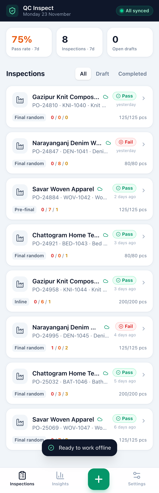
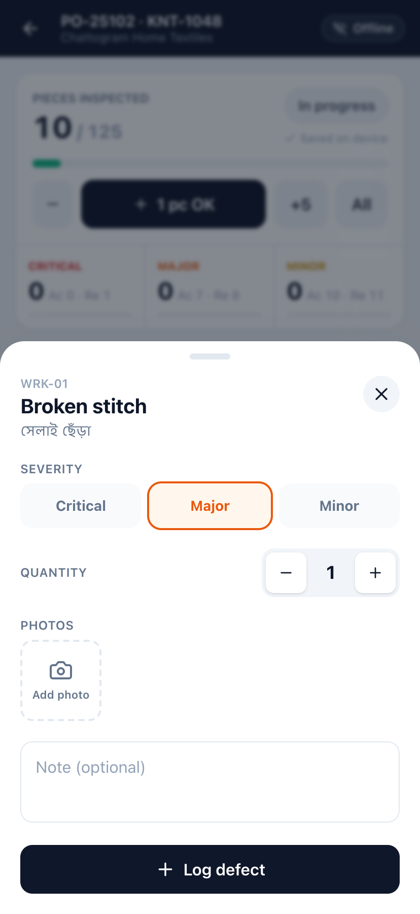
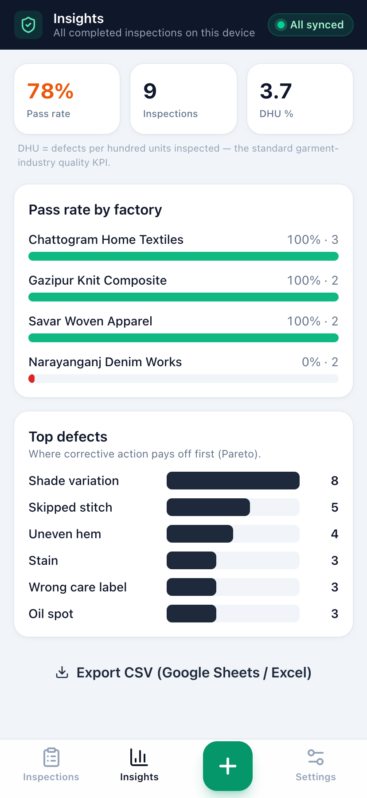
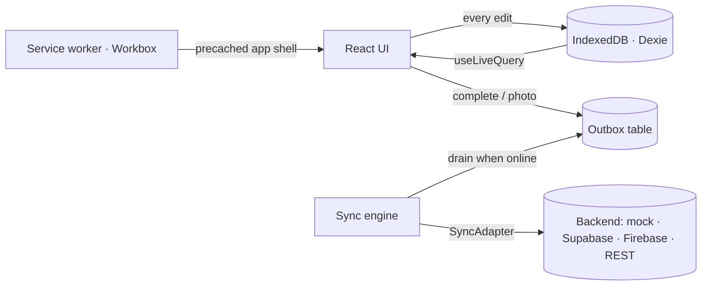

# QC Inspect — offline-first quality inspection PWA

A field app for garment and home-textile quality inspectors working inside factories where
connectivity is weak or absent. Inspectors run AQL inspections, log defects with photos,
take measurements and complete checklists — **entirely offline**. Everything syncs
automatically and safely when a signal returns.

> Built as a working prototype for a digital quality-management solution in the
> Bangladesh sourcing context. Factory names and inspection data are fictional demo data.

| Inspections | Live inspection | Defect + photo | Report | Insights |
|---|---|---|---|---|
|  |  |  |  |  |

## What it does

- **AQL sampling engine (ISO 2859-1 / ANSI Z1.4)** — enter lot size, inspection level and AQL
  values; the app derives the code letter, sample size and Ac/Re numbers, correctly resolving the
  standard's ↑/↓ arrows. Unit-tested against the published tables.
- **Live verdict** — critical / major / minor tallies against their rejection numbers. A lot is
  failed *as soon as* it reaches Re (saves inspector time); passes only once the full sample is checked.
- **Defect library** — 21 coded defects (safety, fabric, workmanship, trims, measurement, packing)
  with default severities the inspector can override; quantity, notes and photos per entry.
- **Photos** — camera capture, on-device resize + JPEG re-encode (4–6 MB → ~300 KB) before
  storage, uploaded in the background as the inspection progresses.
- **Measurements** — points of measure × 5 pieces with tolerance highlighting.
- **Checklist** — approved sample, quantity, carton, labels, drop test, metal detection.
- **Report** — printable / PDF, share sheet, compression savings, sync status.
- **Insights** — pass rate, DHU (defects per hundred units), pass rate by factory, Pareto of top
  defects, **CSV export** for Google Sheets / Excel.
- **English / বাংলা** — UI and defect names switch language, so line QC can use it in their own language.
- **Network simulator** — force *Offline* or *Flaky 3G* (40% of requests dropped) to demo sync behaviour.

## Architecture



**Offline-first, local-first.** The device is the source of truth while offline. Every keystroke
is written to IndexedDB (autosave), so killing the app or a dead battery loses nothing. The app
shell is precached by a Workbox service worker, so it boots with zero connectivity.

**Outbox pattern** (`src/lib/sync/engine.ts`)
1. Writes that must reach the server create a durable outbox row (survives restarts).
2. The engine drains it on `online` events, app focus, a 10 s timer, or a manual “Sync now”.
3. **Photos upload before the inspection** that references them.
4. Failures retry with **exponential backoff + full jitter** (capped at 5 min) so a fleet of devices
   regaining signal after a power cut doesn’t stampede the API.
5. **Idempotent** pushes keyed by client UUIDs → a retried request that already succeeded never duplicates.
6. **Optimistic concurrency**: every edit bumps `version`; a record is only marked synced if it
   wasn’t edited while the upload was in flight, and the server rejects stale versions (`ConflictError`).

**Pluggable backend.** The engine only knows the `SyncAdapter` interface (`pushInspection`,
`pushPhoto`). The demo ships a mock server in a separate IndexedDB so it runs anywhere without
keys. A Supabase adapter is ~20 lines:

```ts
export const supabaseAdapter: SyncAdapter = {
  async pushInspection(i) {
    const { error } = await supabase.rpc('upsert_inspection', { payload: i }); // version check in SQL
    if (error?.code === '40001') throw new ConflictError(error.details as unknown as number);
    if (error) throw error;
    return { serverVersion: i.version };
  },
  async pushPhoto(p) {
    const path = `${p.inspectionId}/${p.id}.jpg`;
    const { error } = await supabase.storage.from('qc-photos').upload(path, p.blob, { upsert: true });
    if (error) throw error;
    return { url: supabase.storage.from('qc-photos').getPublicUrl(path).data.publicUrl };
  },
};
```

**Storage durability.** The app requests `navigator.storage.persist()` so the browser won’t evict
inspection data under storage pressure.

## Tech stack

React 18 · TypeScript (strict) · Vite · Tailwind CSS v4 · Dexie (IndexedDB) · Workbox via
vite-plugin-pwa · Vitest + fake-indexeddb · lucide icons. No runtime network dependencies
(system fonts, inline icons) — nothing breaks offline.

## Run it

```bash
npm install
npm run dev        # http://localhost:5173 (also exposed on your LAN)
npm test           # 30 unit tests: AQL tables, verdict, backoff, sync engine
npm run build && npm run preview   # production build with service worker
```

> Service workers and `crypto.randomUUID` need a secure context: use `localhost`, or deploy
> (HTTPS) to test on a phone.

### Deploy (free, ~2 minutes)

Push to GitHub, then import the repo on **Vercel** or **Netlify** (framework: Vite, build
`npm run build`, output `dist`). SPA rewrites are already configured (`vercel.json`,
`public/_redirects`). Open the URL on an Android phone → “Install app”.

## Project layout

```
src/
  lib/
    aql.ts            ISO 2859-1 sampling engine (+ tests)
    verdict.ts        pass / fail / in-progress rules (+ tests)
    defects.ts        bilingual defect library, POMs, checklist
    db.ts             Dexie schema & types
    repo.ts           domain operations (create, autosave, add defect, complete)
    photos.ts         on-device compression
    sync/             outbox engine, backoff, adapter interface, mock server, network simulator
  pages/              Inspections, NewInspection, Inspect, Report, Insights, Settings
  components/         AppShell, SyncPill, DefectSheet, UI primitives
```

## Roadmap to production

1. **Backend + auth** — Supabase (Postgres + Storage + RLS per factory/role) or Firebase; inspector
   login with offline session caching.
2. **Master data sync** — pull POs, styles, factories, spec sheets and AQL presets per customer
   from the existing ERP / Google Sheets.
3. **Background Sync API** + periodic sync on Android so uploads finish with the app closed.
4. **Photo annotation** (circle the defect), barcode / QR scan of carton labels.
5. **Supervisor review & sign-off**, automatic e-mail of the PDF report to the brand.
6. **Conflict UI** for the rare case a supervisor and inspector edit the same record.
7. **Field pilot** with 2–3 inspectors, measure time-per-inspection vs. paper, iterate.
8. If needed, wrap with Capacitor for Play Store distribution and native camera access.
